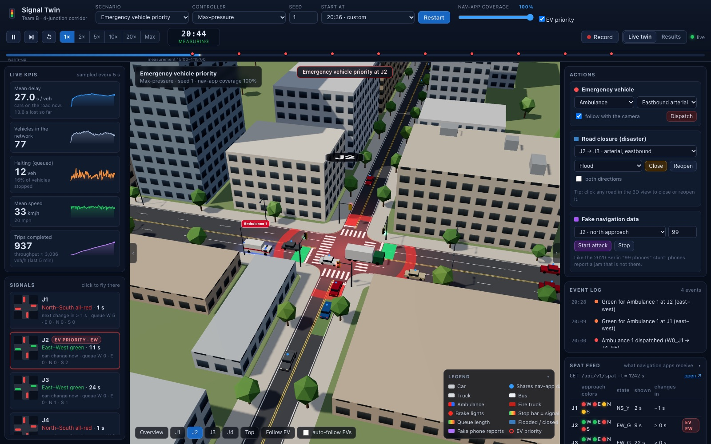
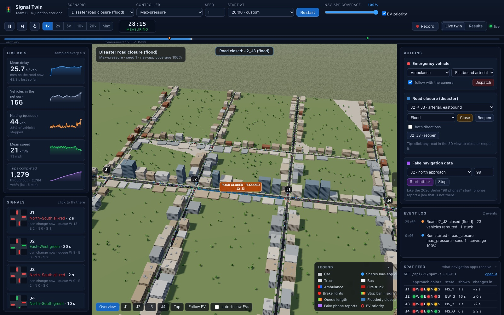

# Team B — Traffic Signal Optimization with Mobility Data and AI

2026 Crimson Silicon Valley SW·AI Leaders Program · Korea University Sejong × CSU East Bay

A SUMO-based **digital twin** of a four-junction corridor. Cars and signals move live in 3D, and
you can switch between signal-control methods, send an ambulance through, flood a road or feed
the AI fake navigation data — then compare the numbers.
SUMO 기반 4교차로 **디지털 트윈**입니다. 차량과 신호가 3D로 실시간 움직이고, 신호 제어 방식을 바꾸거나
구급차 출동·도로 침수·가짜 내비 데이터 공격을 걸어 보면서 결과를 비교할 수 있습니다.

**Cloud live SUMO (private research MVP):** [deployment and safety guide](docs/cloud-live-sumo-deployment.md). A separate Docker-hosted server runs real SUMO and sends live vehicles/KPIs over WebSockets; the GitHub Pages demo alone remains prerecorded. Cloud hosting is **not deployed automatically** and requires an account, compute plan and access password.

**Final project handoff:** [Readiness, reproducibility and Windows sandbox walkthrough](docs/final-project-handoff.md) · [Engineering roadmap and outcomes](docs/final-engineering-review.md) · [Presentation brief](docs/final-presentation-brief.md). Research-only spillback controller was **rejected** after independent validation; original max-pressure remains the baseline.

**Scenario Sandbox (local):** after `python -m teamb twin`, open `http://127.0.0.1:8000/static/sandbox.html`. Export/import JSON there; custom SUMO runs execute separately via the displayed CLI command. The GitHub Pages demo replays recordings and is not a hosted experiment execution service.

**▶ Online demo: https://sunghyunc.github.io/team-b-signal-optimization/** — 13 recorded runs
(rush hour, ambulances, flood, earthquake, fake-data attack, …) replayed in the browser, on phones too.
설치 없이 브라우저(휴대폰 포함)에서 녹화된 시뮬레이션 13개를 바로 볼 수 있습니다.
The page switches between **English and 한국어** (top bar, or `?lang=ko`). 상단의 EN | 한국어 버튼으로 언어를 바꿀 수 있어요.





> The program only requires the five activity reports; this prototype is optional and backs
> Report 3 (problem definition) and Report 5 (results sharing) with results we actually ran.
> Network sizes, timings and demand are design assumptions from Aditya's reference design,
> not field-calibrated values.

## Quick start

For Windows PowerShell with Python 3.11 installed, you can use `py -3.11` in place of `python`. If SUMO executables are not on PATH, see the [Windows handoff](docs/final-project-handoff.md).

Python 3.10+ is needed. `requirements.txt` installs SUMO itself (`eclipse-sumo`), so there is
nothing else to install.

```bash
git clone https://github.com/SungHyunC/team-b-signal-optimization.git
cd team-b-signal-optimization
python3 -m venv .venv
source .venv/bin/activate          # Windows: .venv\Scripts\activate
pip install -r requirements.txt
python -m teamb twin               # open http://127.0.0.1:8000
```

Other entry points:

```bash
python -m teamb list                                              # controllers and scenarios
python -m teamb run --scenario emergency --controller max_pressure # one headless run → results/runs/
python -m teamb.experiments run --name demo --scenarios rush_hour --controllers fixed_time,max_pressure --seeds 1-3
python -m teamb.experiments report --name demo                    # paired comparison → results/experiments/demo/report.md
python -m teamb.analysis.impact results/experiments/demo          # impact & cost-benefit table
python -m pytest                                                  # all tests
python -m teamb.twin.site deploy                                  # re-record and publish the online demo
```

In the twin, URL parameters jump straight to a demo moment, e.g.
`http://127.0.0.1:8000/?scenario=emergency&controller=max_pressure&start=1170&speed=2&camera=J1`.
Before presenting offline, run `python -m teamb.twin.vendor` once (saves three.js locally).

## What's inside

**Signal controllers** (`teamb/controllers/`), all behind the same safety supervisor:

| Name | Method | Role in the plan |
|---|---|---|
| `fixed_time` | same 90 s timing every cycle | baseline |
| `coordinated` | fixed-time with green-wave offsets | baseline |
| `actuated` | extends green while loop detectors see cars | baseline |
| `max_pressure` | green to the axis with the biggest queue imbalance | strong baseline |
| `max_pressure_probe` | max-pressure on navigation data only (security test) | security |
| `ai_recommender` | Optuna searches cycle/splits/offsets on a model built from navigation data → engineer approves → applied (Google Green Light style) | core |
| `rl` | Q-learning controller trained in SUMO (Busan-style real-time control) | stretch |

**Scenarios** (`teamb/scenarios/`, details in [`docs/scenarios.md`](docs/scenarios.md)):

| Name | What happens |
|---|---|
| `rush_hour` | morning peak, heavy eastbound arterial (ramps up, peaks 25 min, eases off) |
| `off_peak` | light night traffic with more trucks |
| `special_event` | a stadium north of J3 empties onto one cross street |
| `emergency` | 10 ambulances/fire trucks from every side during the peak |
| `road_closure` | a flash flood closes the arterial J2 → J3 for 30 min; detour over the back street |
| `sinkhole_cross` | a sinkhole closes the cross street north of J2 |
| `earthquake` | several closures plus emergency response |
| `fake_data_attack` | 99 fake "phones" report a jam on J2's north approach (2020 Berlin case) |

**First results** (3 paired seeds, synthetic demand — pilot numbers; full tables in [`docs/results/`](docs/results/README.md)):

| Controller | Rush hour delay (s/veh) | vs fixed-time | Flood closure delay | Fake-data attack delay |
|---|---:|---:|---:|---:|
| fixed_time | 71.0 | — | 119.6 | 79.5 |
| coordinated | 48.4 | −31.8 % | | |
| ai_recommender | 37.6 | −47.0 % | | |
| actuated | 30.7 | −56.7 % | 83.8 | |
| rl | 30.6 | −56.7 % | 170.2 (unstable) | |
| max_pressure | 29.2 | −58.7 % | 94.7 | 29.4 |
| max_pressure_probe (navigation data only) | | | | 175.6 → 48.2 with the detector cross-check |

Two lessons for Report 3: the RL controller, trained only on rush hour, breaks down when a road
floods; and a controller that trusts navigation data alone can be steered by fake reports unless
it cross-checks the loop detectors. Emergency vehicles cross the corridor in ≈ 90 s instead of 110 s.

**How the prototype tests our three questions from Report 1**

| Question | Experiment |
|---|---|
| Sampling bias — is navigation data enough? | vary probe coverage 10/25/50/75/100 % (and biased sampling) and compare the AI recommender's plan and the metrics |
| Spillover — does fixing one junction clog the next? | four connected junctions; road-closure scenario measures how far and how long queues spread |
| Measuring impact fairly | same seeds for every controller → paired A/B comparison with 95 % confidence intervals; unfinished trips always reported |

**Safety first:** controllers only *propose* a green direction. The independent supervisor
(`teamb/safety/`) enforces minimum green, yellow and all-red, rejects invalid proposals, gives
emergency vehicles a green path, and falls back to fixed-time if a controller fails.

**Signal-data API** for navigation apps (like Busan's): `GET /api/v1/spat` and friends while the twin runs.

## Repository map

| Path | What | Owner |
|---|---|---|
| `teamb/network/`, `teamb/sim/`, `teamb/safety/`, `teamb/twin/` | SUMO network, simulation loop, safety supervisor, 3D digital twin | Seong Hyeon |
| `teamb/sensors/`, `teamb/evaluation/`, `teamb/experiments/` | loop detectors & navigation probes, metrics, batch experiments & statistics | Doyoung |
| `teamb/controllers/` | actuated, max-pressure, AI recommender, RL, fake-data defense | Yunseong |
| `teamb/scenarios/`, `teamb/demand/`, `teamb/api/`, `teamb/analysis/` | scenarios & demand, signal-data API, impact & cost-benefit | Aditya (with Doyoung) |
| `docs/ARCHITECTURE.md` | how the parts connect, data contracts | everyone |
| `docs/ROLE_GUIDE.md` | 역할별로 어디를 고치면 되는지 · what each of us can change next | everyone |

## Team

| Member | Role |
|---|---|
| Joshua (Seong Hyeon) Kim | Software & integration, team lead |
| Doyoung Lee | Data & evaluation |
| Yunseong Lee | AI & security |
| Aditya Tirunagaru | Scenario design, impact & cost-benefit analysis |

## Documents

| File | What it is | Language |
|---|---|---|
| [`docs/topic/topic-candidates_2026-10-12_KR.pdf`](docs/topic/topic-candidates_2026-10-12_KR.pdf) | Sub-topic candidates under the main theme · 세부 주제 후보 | KR |
| [`docs/topic/chosen-topic_traffic-signal-optimization_KR.pdf`](docs/topic/chosen-topic_traffic-signal-optimization_KR.pdf) | Our chosen topic (one page) · 확정 주제 | KR |
| [`docs/activity-reports/report-1_research-plan_2026-10-13_KR.pdf`](docs/activity-reports/report-1_research-plan_2026-10-13_KR.pdf) | Report 1: Research & Plan, first version · 활동보고서 ❶ 조사·계획 | KR |
| [`docs/activity-reports/report-1_research-plan_revised_2026-10-15_KR.pdf`](docs/activity-reports/report-1_research-plan_revised_2026-10-15_KR.pdf) | Report 1, revised (latest) · ❶ 수정본(최신) | KR |
| [`docs/research/Team_B_Comprehensive_Traffic_AI_Research_Report.pdf`](docs/research/Team_B_Comprehensive_Traffic_AI_Research_Report.pdf) | Research report by Aditya · Aditya 연구보고서 | EN |
| [`docs/research/`](docs/research/) `Team_B_*.docx` | Role packages for software, big data and AI, by Aditya · 역할 문서 3종 | EN |
| [`docs/plans/prototype-plan_EN.pdf`](docs/plans/prototype-plan_EN.pdf) | Prototype plan (optional) | EN |
| [`docs/plans/prototype-plan_KR.pdf`](docs/plans/prototype-plan_KR.pdf) | 프로토타입 제작 계획 | KR |
| [`docs/ARCHITECTURE.md`](docs/ARCHITECTURE.md) | Prototype architecture and data contracts | EN |
| [`docs/ROLE_GUIDE.md`](docs/ROLE_GUIDE.md) | Who changes what next · 역할별 수정 가이드 | KR/EN |

## Schedule (from the program book)

| Date | Plan |
|---|---|
| Nov 1 (Sun) | Depart Incheon, arrive San Francisco |
| Nov 2 (Mon) | KIC Silicon Valley, **Google** — Seong Hyeon's questions |
| Nov 3 (Tue) | **Tesla** Fremont Factory, Apple Park, expert panel — Yunseong's questions |
| Nov 4 (Wed) | Amazon Tracy fulfillment center, **Databricks** — Doyoung's questions |
| Nov 5 (Thu) | CSU East Bay: lectures, joint session with Aditya, **team presentation 16:00** |
| Nov 6 (Fri) | Pensive, depart San Francisco |
| Nov 8 (Sun) | Arrive in Korea |
